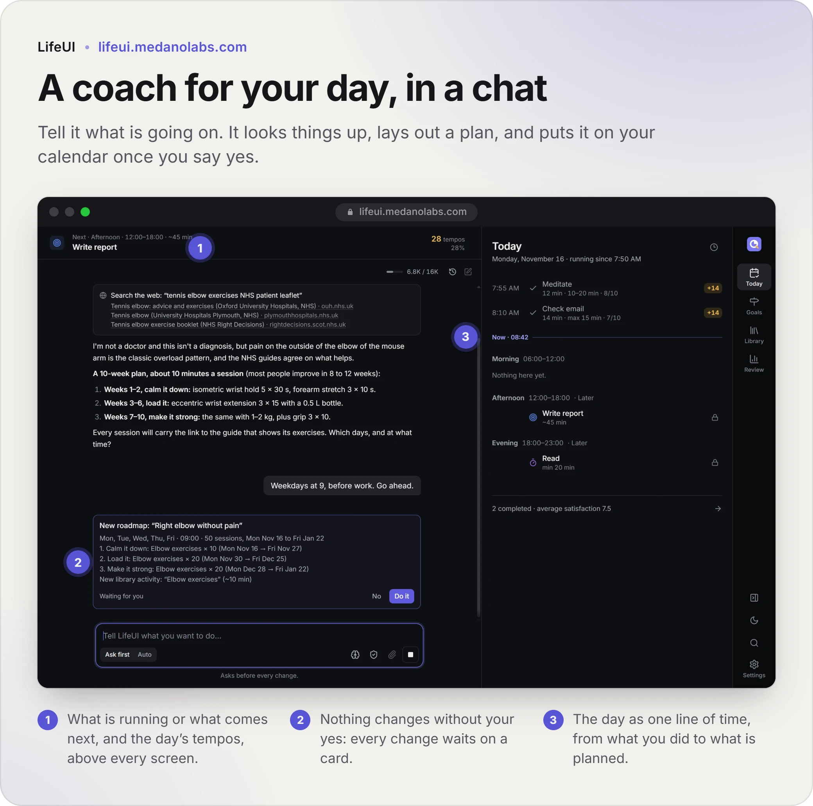
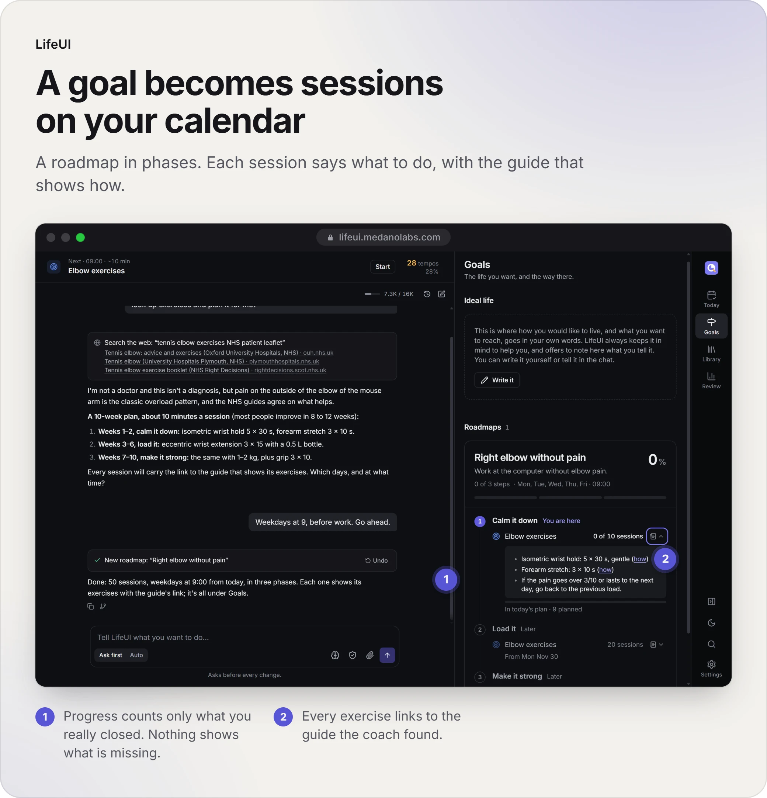
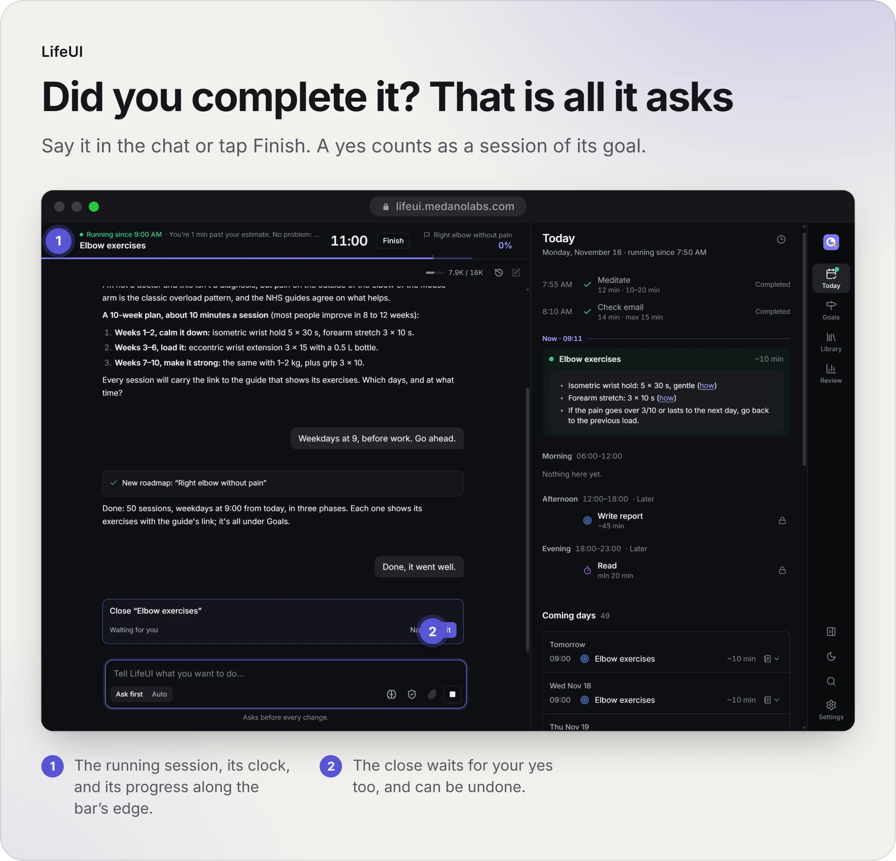
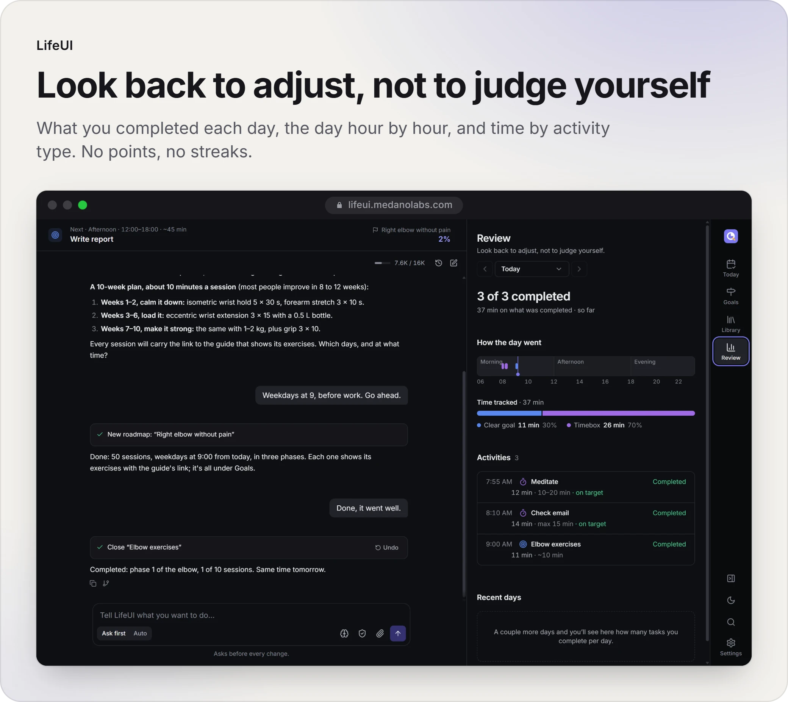
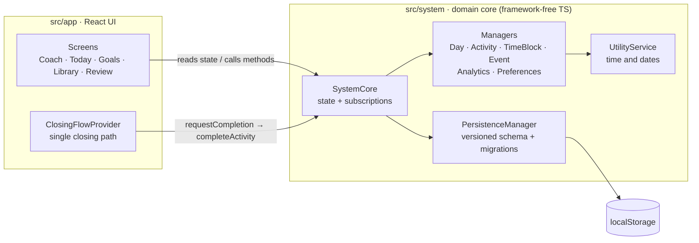

# LifeUI

LifeUI is an open-source AI coach for planning your day. It wraps a language model, running locally (Ollama or LM Studio) or through an API you choose (OpenRouter, OpenAI, Gemini and others), with tools that edit your day, a memory of what you told it, and one fixed rule: nothing changes without your confirmation. It looks things up, lays out a plan and puts each session on your calendar once you approve it. Your data stays on your machine; only the web searches you allow go out.

**[Download the desktop app](https://github.com/Felichz/life-ui/releases/latest)** (Windows, macOS, Linux) · [Website and film](https://lifeui.medanolabs.com) · [Web app](https://lifeui.medanolabs.com/app/) · [Case study](https://felix.medanolabs.com/work/lifeui/) · Built by [Felix Andersson](https://felix.medanolabs.com/)

<picture>
  <source media="(prefers-color-scheme: dark)" srcset="docs/readme/01-coach-dark.webp">
  
</picture>

<sub>The pictures follow your GitHub theme (light or dark). Screenshots use synthetic demo data.</sub>

## What it is

The app is a conversation with a coach that can change your day, with every change gated on your approval ([ADR-002](docs/adr/002-agent-mediated-app.md), [ADR-009](docs/adr/009-coach-and-web-research.md)). The layout ([ADR-013](docs/adr/013-the-conversation-in-the-middle.md)):

- The conversation sits in the middle of every screen.
- A thin bar above it shows what is running and for how long (or what comes next), and the goal it works toward.
- A resizable, collapsible side panel shows the day as a single timeline, your goals, your library or a review.

Each change the coach proposes waits on a card ("Do it" / "No"); in Auto mode it applies and can be undone. With your permission it searches the web, and the sources it used are listed under the search.

A goal that takes weeks becomes a roadmap ([ADR-011](docs/adr/011-a-roadmap-owns-its-sessions.md)): phases of scheduled sessions, each with what to do and a linked guide. The coach keeps notes on what you told it (goals, resources, limits) so it only asks for what is missing ([ADR-012](docs/adr/012-the-coachs-notes.md)).

<picture>
  <source media="(prefers-color-scheme: dark)" srcset="docs/readme/02-goals-dark.webp">
  
</picture>

Progress measures completion ([ADR-015](docs/adr/015-goals-not-tempos.md)). Any task for today starts with one tap on the panel or a message to the coach. When it ends, the app asks whether you completed it. A yes counts as a session toward its goal and advances the phase and the percentage; a no is recorded without penalty. There are no points or streaks.

<picture>
  <source media="(prefers-color-scheme: dark)" srcset="docs/readme/03-close-dark.webp">
  
</picture>

<picture>
  <source media="(prefers-color-scheme: dark)" srcset="docs/readme/04-review-dark.webp">
  
</picture>

<picture>
  <source media="(prefers-color-scheme: dark)" srcset="docs/readme/05-phone-dark.webp">
  
</picture>

The interface is in English and Spanish, with light and dark themes (toggle on the rail). It opens in English; switch to Spanish in Settings or from the command palette.

## How it's built

The domain logic and the UI are separate layers. The UI never re-implements a rule: it reads state and calls the core.



- **Framework-free domain core.** [`src/system`](src/system) is plain TypeScript with no React imports. `SystemCore` ([`index.tsx`](src/system/index.tsx)) applies every change to a copy of the state, persists it, then notifies subscribers. Managers own each area (days, activities, time blocks, events, analytics, preferences). The UI reaches the core through one adapter, [`src/app/state/system.tsx`](src/app/state/system.tsx), and the UI tests drive a real `SystemCore` instead of mocks.
- **Versioned persistence with migrations.** [`persistenceManager.ts`](src/system/persistenceManager.ts) runs every load through parse, validate, migrate (schema v1 to v2 to v3), sanitize. Fields removed in v3 are moved into a `legacyArchive` object instead of being discarded. JSON import in Settings goes through the same path as a normal load, and export produces the same format that goes to `localStorage`.
- **Progress is computed, not stored.** A roadmap's progress is derived from the closes marked as done ([`directionManager.ts`](src/system/directionManager.ts)); the closing dialog, the HUD and the coach read it through one helper ([`goals.ts`](src/app/lib/goals.ts)).
- **One closing path.** Finishing, switching activity and ending the day all run through `requestCompletion → dialog → completeActivity | interruptActivity` ([`src/app/state/closing.tsx`](src/app/state/closing.tsx)). The next action only runs if the close was saved, and dismissing the dialog leaves the activity running.
- **Typed i18n with no dependencies.** [`es.ts`](src/app/i18n/es.ts) is the reference copy and defines `MessageKey`; [`en.ts`](src/app/i18n/en.ts) is typed `Record<MessageKey, string>`, so a missing or extra key fails the type check. A test checks that both languages use the same `{placeholders}` in every string. Plurals use `Intl.PluralRules`, and dates and numbers use `Intl` in the active language.
- **CI.** [`.github/workflows/ci.yml`](.github/workflows/ci.yml) runs on every push to `main` and on pull requests: typecheck, lint with zero warnings allowed, Jest, the production build, and then Cypress against the built app.
- **Offline-first.** No backend. All data stays in the browser, and Settings can export and import a JSON backup.

## Stack

React 18, TypeScript (strict), Vite, React Router, Tailwind CSS with CSS-variable design tokens and container queries, Radix UI primitives, Inter (self-hosted), Tauri 2 (Rust) for the desktop app, Jest with Testing Library, Cypress, GitHub Actions, Cloudflare Workers.

## Getting started

Requires Node 20 or newer.

```bash
git clone https://github.com/Felichz/life-ui.git
cd life-ui
npm install
npm run dev          # http://localhost:5174
```

| Script                  | What it does                                                                            |
| ----------------------- | --------------------------------------------------------------------------------------- |
| `npm run dev`           | Vite dev server on port 5174                                                            |
| `npm run build`         | Type-check and build for production into `dist/`                                        |
| `npm run preview`       | Serve the production build on port 5174                                                 |
| `npm run desktop`       | The desktop app (Tauri) in development; needs Rust                                      |
| `npm run desktop:build` | Build the desktop app's installer for this machine                                      |
| `npm run build:site`    | Build the website into `dist-site/`: the landing page at `/`, the web app under `/app/` |
| `npm run typecheck`     | Type-check the app, tooling and Cypress projects                                        |
| `npm run lint`          | ESLint with Prettier, zero warnings allowed                                             |
| `npm test`              | Unit and integration tests (Jest)                                                       |
| `npm run test:e2e`      | End-to-end run in Cypress (needs `npm run dev` running)                                 |
| `npm run sim`           | Talk to the real agent and a local model from the terminal (see `scripts/sim/sim.ts`)   |

`npm run sim:score -- <transcript.txt>` scores a transcript written by the runner: it checks the saved roadmap against what the person said (days, session counts, phases, minutes, loads, rules, the coach's numbers). It checks facts only; a passing score does not measure coaching quality.

Keyboard: `Ctrl/⌘ K` command palette · `Ctrl/⌘ B` show or hide the panel · `G` then `H`/`M`/`B`/`R`/`A` to open Today, Goals, Library, Review or Settings.

## Testing

450 Jest tests across 31 suites, plus 6 Cypress end-to-end tests.

- **Core** ([`src/system/__tests__`](src/system/__tests__)): unit tests for the managers and persistence (including migrations and import), plus integration tests for starting a day, the library, planning, and the closing flow.
- **UI** ([`src/app/__tests__`](src/app/__tests__)): view-logic tests, i18n key and placeholder parity, and flow tests that render the real app against a real `SystemCore`: closing as done or not done, switching activity through the close, cancelling, and starting from the panel.
- **End to end** ([`cypress/e2e/journey.cy.ts`](cypress/e2e/journey.cy.ts)): first run through ending the day in the browser, the conversation as its own screen on a phone, the language switch, and redirects from the old Spanish routes.

The README screenshots come from a separate Cypress spec: a scripted conversation with the coach through the real agent and core, with synthetic data, captured in both themes (`npm run dev` must be running). The panels around the shots are drawn by the portfolio's `scripts/readme/build.mjs`.

```bash
npx cypress run --browser chrome --config-file cypress.screenshots.config.ts
```

## Project structure

```
src/
  system/              domain core: SystemCore, managers, UtilityService, persistence
    __tests__/         unit and integration tests for the core
  app/
    agent/             the coach: its turn loop, tools, notes, planner and the chat
    state/             core adapter, closing flow, theme, toasts
    features/          today, goals, library, review, settings, plus the activity dialogs
    components/ui/     design-system primitives (Button, Dialog, Menu, Tooltip...)
    shell/             app shell: the HUD, the rail, the resizable panel, the command palette
    i18n/              typed EN/ES messages
    lib/               formatting and read-only view helpers
  types.ts             shared domain types
cypress/e2e/           end-to-end journey and README screenshot specs
src-tauri/             the desktop shell (Rust): system resources, model runtimes, local state
site/                  the landing page of lifeui.medanolabs.com
worker/                the Worker that sends deep links to the web app under /app/
video/                 the product film (HyperFrames), captured from the real app
docs/adr/              architecture decision records
```

## Decisions

- [ADR-015: goals, not tempos](docs/adr/015-goals-not-tempos.md): a task is done or not, and progress is measured toward a goal (replaces ADR-001, the tempo system).
- [ADR-013: the conversation in the middle](docs/adr/013-the-conversation-in-the-middle.md): the coach-centred shell, the HUD and the one context panel.
- [`PRODUCT.md`](PRODUCT.md): users, purpose and product principles.
- [`DESIGN.md`](DESIGN.md): the visual system (tokens, type, components, rules).

## Desktop app and releases

The primary target is the desktop: a Tauri app that runs the coach on a local model (Ollama or LM Studio) and keeps its state in a file on your machine. Each [release](https://github.com/Felichz/life-ui/releases/latest) has:

| System  | File                                | What it is                                                                                                                                                                      |
| ------- | ----------------------------------- | ------------------------------------------------------------------------------------------------------------------------------------------------------------------------------- |
| Windows | `LifeUI_<version>_x64-setup.exe`    | The installer, for your user (no admin needed)                                                                                                                                  |
| Windows | `LifeUI_<version>_x64_en-US.msi`    | The same as an MSI, for managed installs                                                                                                                                        |
| Windows | `LifeUI_<version>_x64_portable.zip` | Nothing to install: `LifeUI.exe` keeps everything (the day, the library, the conversations) in the `LifeUI-data` folder beside it. Needs WebView2, which Windows 10 and 11 have |
| macOS   | `LifeUI_<version>_universal.dmg`    | Apple silicon and Intel                                                                                                                                                         |
| Linux   | `.AppImage`, `.deb`, `.rpm`         | x86_64                                                                                                                                                                          |

The builds are not signed with a paid certificate, so the system asks once before the first launch. On Windows, SmartScreen may say "Windows protected your PC": choose More info, then Run anyway. On macOS, right-click the app, choose Open, then Open again.

`npm run desktop` runs the app from source and `npm run desktop:build` builds this machine's packages into `src-tauri/target/release/bundle/` (Node 20 or later and Rust).

**Making a release.** GitHub Actions ([`release.yml`](.github/workflows/release.yml)) builds all of the above on Windows, macOS and Linux runners. Set the version in `src-tauri/tauri.conf.json`, `src-tauri/Cargo.toml` and `package.json`, then push a tag with it:

```bash
git tag v0.2.0
git push origin v0.2.0
```

The release is created as a draft with every file attached; review it on GitHub and publish it. The website's download button points at the latest published release.

## Deploying

[lifeui.medanolabs.com](https://lifeui.medanolabs.com) is a Cloudflare Worker with static assets ([`wrangler.jsonc`](wrangler.jsonc)). `npm run build:site` builds what it serves into `dist-site/`: the landing page in [`site/`](site/) at the root and the web build of the app under `/app/`. [`worker/index.js`](worker/index.js) routes deep links under `/app/` to the app and redirects the old root paths (`/goals`, `/library`, ...) to `/app/`. The `deploy` script builds and publishes it; `deploy:staging` goes to lifeui-stg.medanolabs.com.

The landing-page film is rendered from [`video/`](video/README.md) and copied to `site/media/` as `lifeui-film-light.mp4` and `lifeui-film-dark.mp4`.

## License

[MIT](LICENSE) © Felix Andersson
